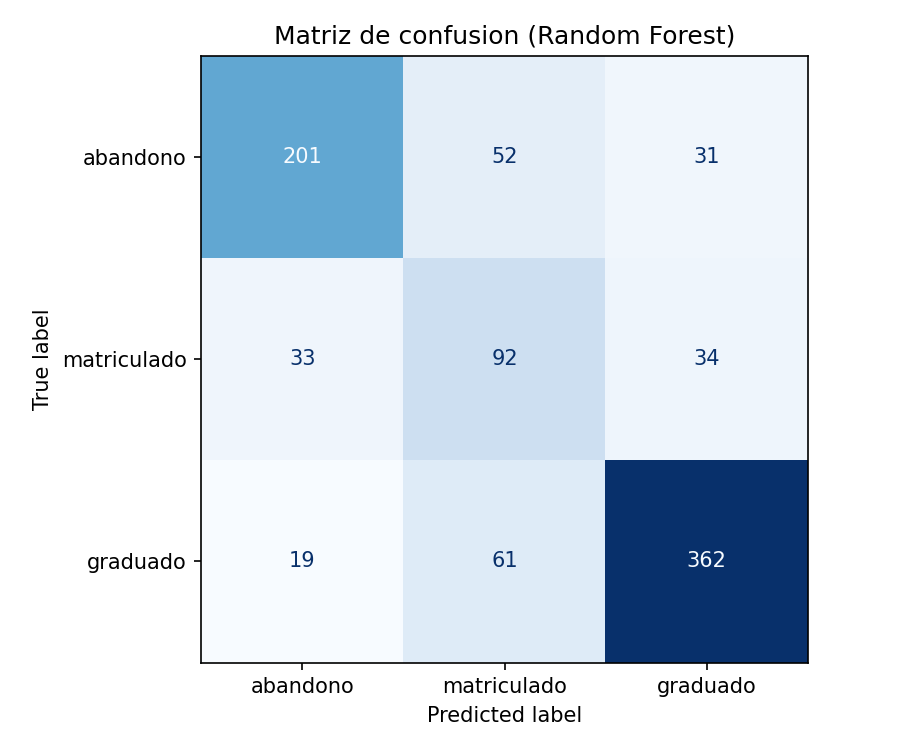
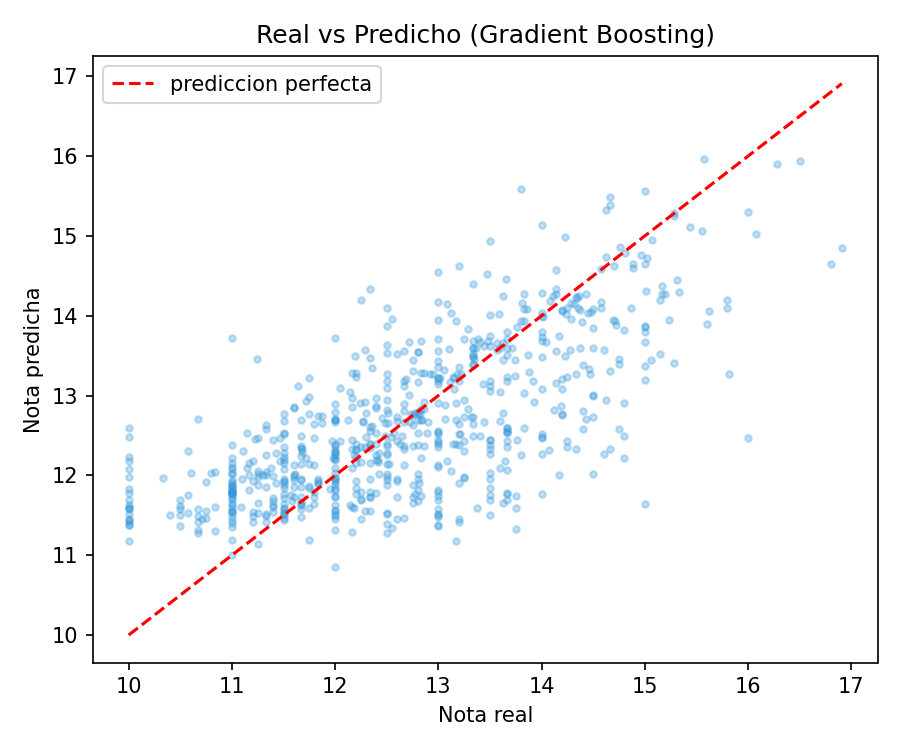
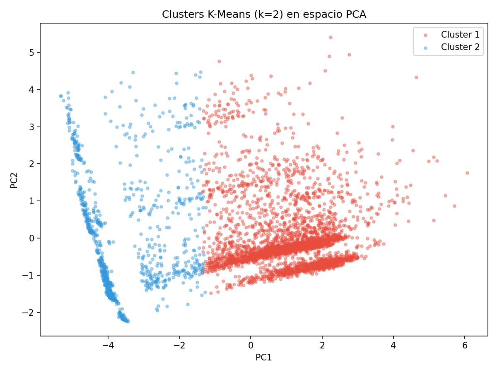

# Predicción del éxito académico en educación superior

**Autor:** Jorge León Cano  
**Asignatura:** Aprendizaje Automático, curso 2025/2026  
**Universidad:** Universidad Pontificia Comillas (ICAI)

## Qué hay en este proyecto

El dataset tiene información académica, demográfica y socioeconómica de 4.424 estudiantes universitarios. A partir de ahí hago tres cosas:

1. **Clasificación:** predecir si el estudiante acaba graduándose, abandonando o sigue matriculado.
2. **Regresión:** predecir su nota media del segundo semestre, sin usar ninguna variable de ese semestre para no meter data leakage.
3. **No supervisado:** agrupar a los estudiantes sin usar etiquetas, con PCA y K-Means.

La conclusión es la misma en los tres análisis: lo que más pesa es el rendimiento del primer semestre. El análisis completo está en [`informe.pdf`](informe.pdf).

## Resultados

Todos los números salen de ejecutar el código tal cual, con `random_state=42`. Los hiperparámetros se eligen con GridSearchCV (KFold, k = 5) y los resultados son sobre el 20 % de test, que no se usa para nada más.

### Clasificación

| Modelo | F1-macro en CV | F1-macro en test | Accuracy en test |
|---|---|---|---|
| Regresión Logística | 0,703 | 0,686 | 0,723 |
| Random Forest (el elegido) | 0,714 | 0,696 | 0,740 |
| Gradient Boosting | 0,712 | 0,699 | 0,766 |

Los tres modelos se quedan prácticamente igual, así que el límite lo pone el problema y no el modelo. Por clase, Random Forest va bien con "graduado" (F1 = 0,83) y "abandono" (0,75) y bastante peor con "matriculado" (0,51).



### Regresión

| Modelo | RMSE en CV | RMSE en test | R² en test |
|---|---|---|---|
| Regresión Lineal | 1,128 | 1,066 | 0,355 |
| Ridge | 1,119 | 1,057 | 0,365 |
| Random Forest | 0,960 | 0,944 | 0,493 |
| Gradient Boosting (el elegido) | 0,944 | 0,942 | 0,495 |

Gradient Boosting se equivoca de media menos de 1 punto en una nota que va de 0 a 18,57. La variable que más pesa es `nota_media_1sem`, con un 62 % de la importancia.



### No supervisado

Con 11 variables de rendimiento y perfil básico, la primera componente del PCA explica el 46,3 % de la varianza. El mejor número de clusters es k = 2 (silueta 0,407):

| | Cluster 0 | Cluster 1 |
|---|---|---|
| Nota media 1er semestre | 12,81 | 3,57 |
| Tasa de aprobación 1er semestre | 70,2 % | 7,9 % |
| Acaban graduándose | 63,0 % | 7,4 % |
| Acaban abandonando | 16,8 % | 82,2 % |

Sin ver ninguna etiqueta, el algoritmo encuentra dos grupos y no tres. Los matriculados no forman un grupo propio, y por eso son la clase más difícil de clasificar.



## Estructura

```
.
├── rendimiento_estudiantes.csv   # dataset
├── limpieza.py                   # carga y limpieza de datos
├── cv.py                         # GridSearchCV para clasificación y regresión
├── clasificacion.py              # Tarea 1
├── regresion.py                  # Tarea 2
├── no_supervisado.py             # Tarea 3
├── figuras/                      # las figuras que salen al ejecutar los scripts
├── informe.pdf                   # el informe
└── requirements.txt
```

## Cómo reproducir los resultados

```bash
pip install -r requirements.txt
python clasificacion.py
python regresion.py
python no_supervisado.py
```

`limpieza.py` y `cv.py` no se ejecutan directamente, son módulos que importo en los demás. El dataset tiene que estar en el mismo directorio que los scripts.

Cada script imprime los resultados por consola y guarda sus figuras en el directorio desde el que se ejecuta. `clasificacion.py` y `regresion.py` lanzan GridSearchCV, así que tardan unos minutos (unos 9 en total con dos núcleos).

Las versiones con las que está probado son las de `requirements.txt`: scikit-learn 1.8.0, pandas 3.0.2, numpy 2.4.4 y matplotlib 3.10.8, con Python 3.12.

## Sobre el informe

El informe es una versión revisada en noviembre de 2026. La versión que entregué en mayo tenía los resultados de antes de añadir GridSearchCV, y aquí están actualizados para que coincidan con lo que da el código. El texto y las conclusiones son los mismos.

La exploración inicial de los datos la hice en un cuaderno aparte que no está en el repositorio.

## Datos

El dataset es una versión traducida al español, facilitada en la asignatura, de *Predict Students' Dropout and Academic Success* (Realinho, Machado, Baptista y Martins), publicado en el [UCI Machine Learning Repository](https://archive.ics.uci.edu/dataset/697) con licencia CC BY 4.0.
